# ООАП: лабораторные работы по UML

Предметная область: **СКУД** (система контроля и управления доступом). Пропуск сотрудников через двери по карте или биометрии с учётом расписания доступа и аварийных режимов.

Все диаграммы всех лабораторных работ лежат в одном файле [СКУД.drawio](СКУД.drawio), каждая на своей странице. Страницы сгруппированы по работам: «ЛР1 — …», «ЛР2 — …».

Редактор диаграмм: [draw.io](https://app.diagrams.net/). Нотация по учебнику: Моисеев А.Н., Литовченко М.И. «Основы языка UML», 2023.

## Лабораторная работа №1. Модель предметной области, диаграммы коммуникаций и анализа

| Файл | Содержимое |
|---|---|
| [СКУД.drawio](СКУД.drawio) | Диаграммы ЛР1 на страницах «ЛР1 — …» |
| [lab1/СКУД_ЛР1_описание.docx](lab1/СКУД_ЛР1_описание.docx) | Текстовое описание каждой диаграммы |
| [lab1/png](lab1/png) | Экспорт диаграмм, масштаб 200% |

### Модель предметной области
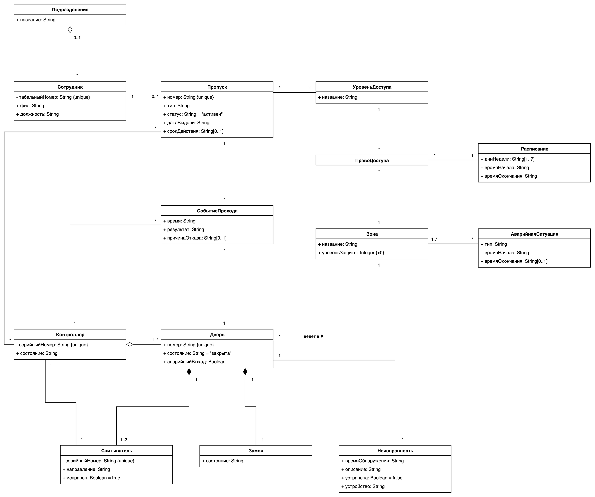

### Диаграмма коммуникаций «Проход сотрудника»
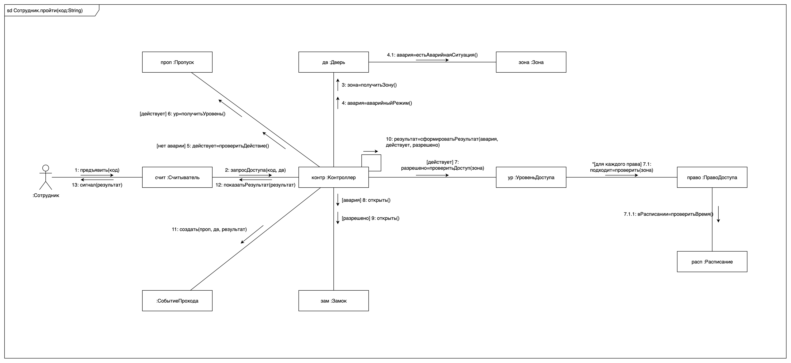

### Диаграмма анализа «Проход сотрудника»
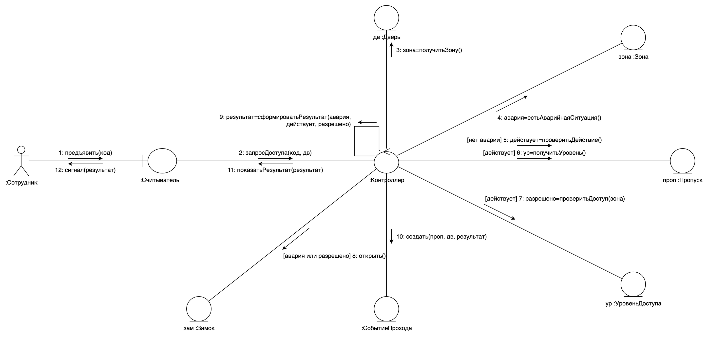

### Диаграмма анализа «Аварийная ситуация»
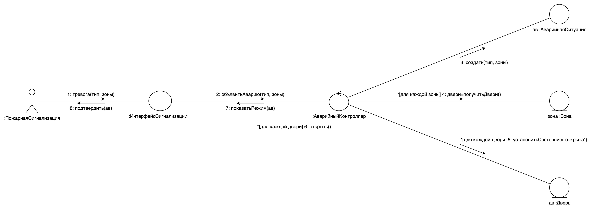

## Лабораторная работа №2. Диаграммы классов, последовательностей и объектов

| Файл | Содержимое |
|---|---|
| [СКУД.drawio](СКУД.drawio) | Диаграммы ЛР2 на страницах «ЛР2 — …» |
| [lab2/СКУД_ЛР2_описание.md](lab2/СКУД_ЛР2_описание.md) | Текстовое описание каждой диаграммы |
| [lab2/СКУД_ЛР2.pdf](lab2/СКУД_ЛР2.pdf) | Диаграммы, описания и код одним документом |
| [lab2/Skud.cs](lab2/Skud.cs) | Программный код на C#, соответствующий диаграммам |
| [lab2/png](lab2/png) | Экспорт диаграмм, масштаб 200% |

### Диаграмма классов 1 из 2: пропуска, зоны и двери
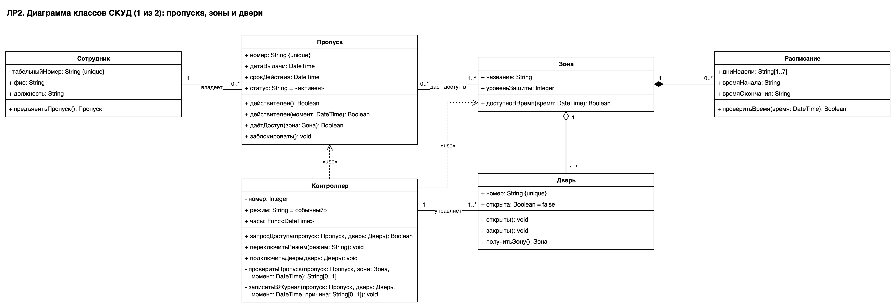

### Диаграмма классов 2 из 2: считыватели, журнал и аварийный режим
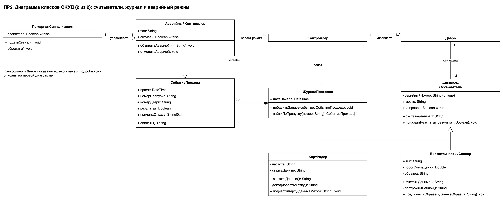

### Диаграмма объектов «Проход сотрудника Иванова»
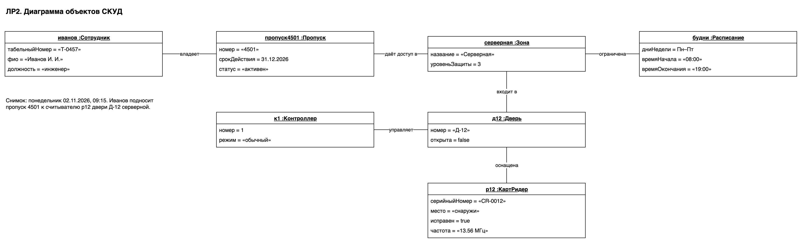

### Диаграмма последовательностей 1 из 3: проход через дверь
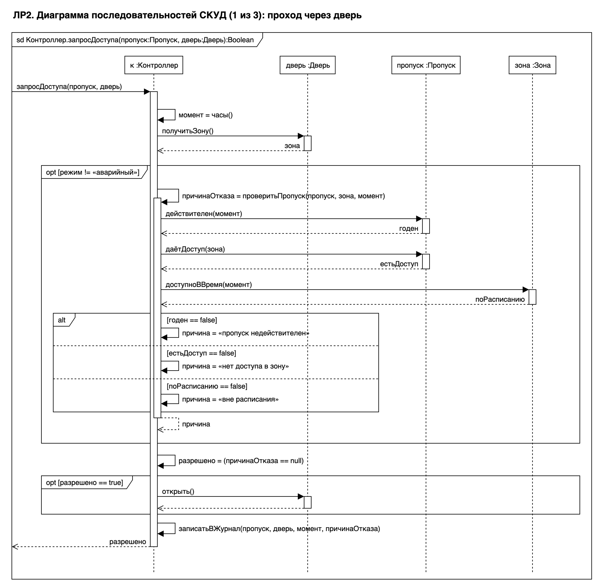

### Диаграмма последовательностей 2 из 3: пожар
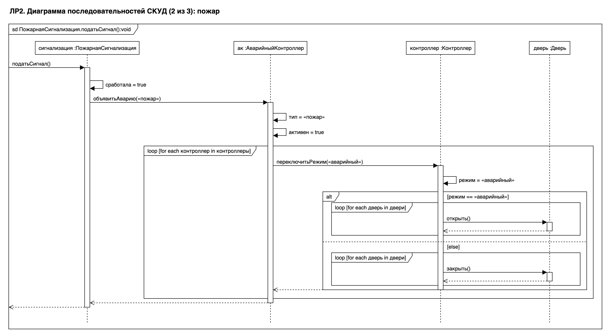

### Диаграмма последовательностей 3 из 3: запись в журнал
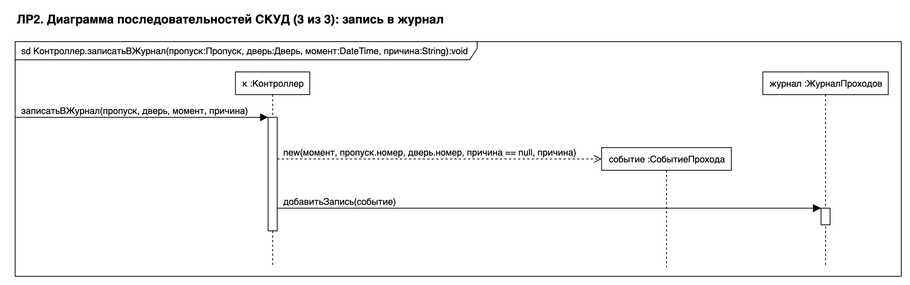

## Лабораторная работа №3. Диаграммы вариантов использования

| Файл | Содержимое |
|---|---|
| [СКУД.drawio](СКУД.drawio) | Диаграммы ЛР3 на страницах «ЛР3 — …»: PERCo-Web, Kisi и наша |
| [lab3/СКУД_ЛР3_описание.docx](lab3/СКУД_ЛР3_описание.docx) | Описание трёх диаграмм и сценарий прецедента «Пройти через дверь» |
| [lab3/СКУД_ЛР3.pdf](lab3/СКУД_ЛР3.pdf) | Тот же документ в PDF для сдачи |
| [lab3/png](lab3/png) | Экспорт нашей диаграммы, масштаб 200% |

### Диаграмма вариантов использования нашего проекта
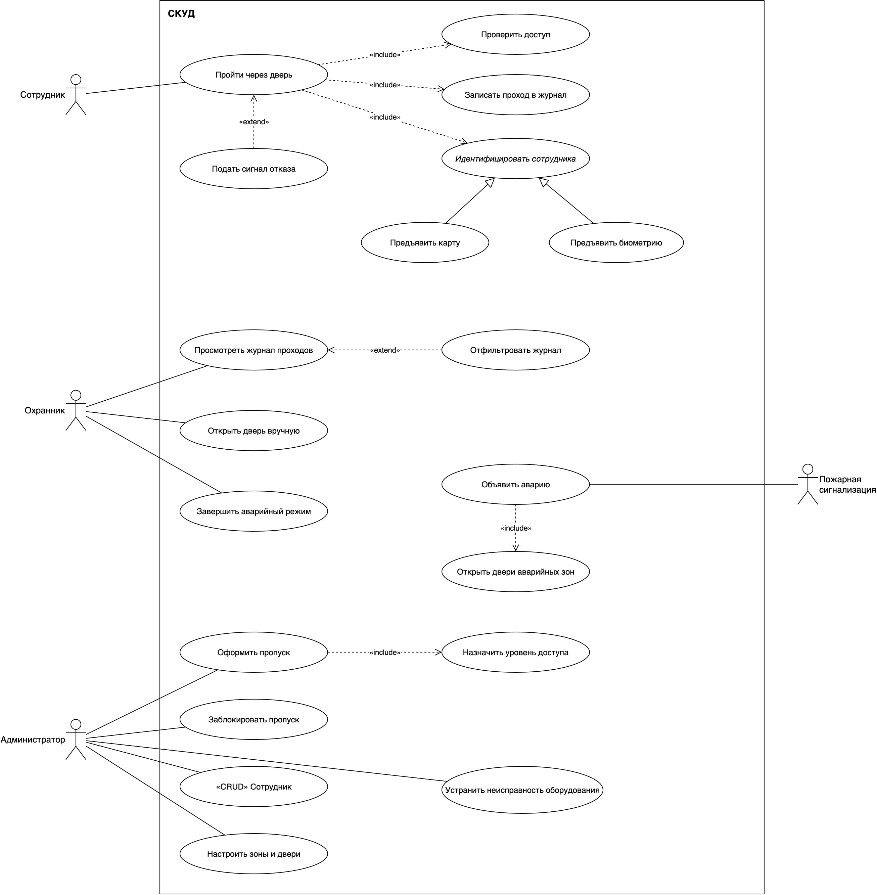
